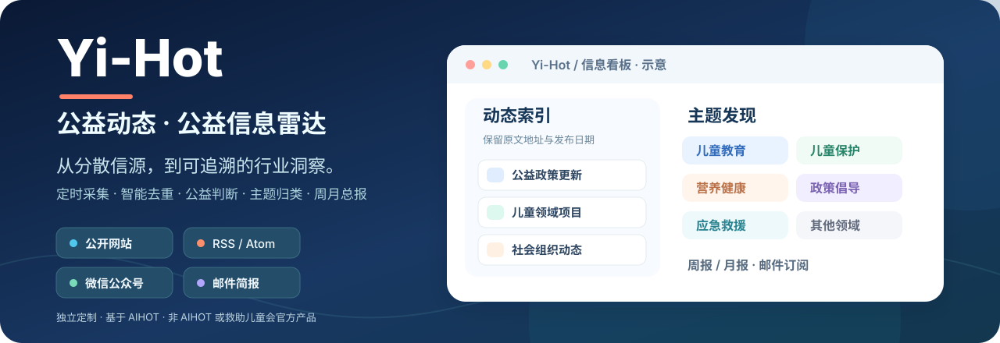
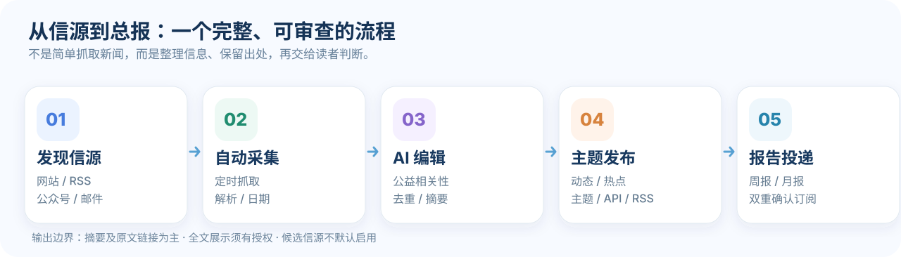
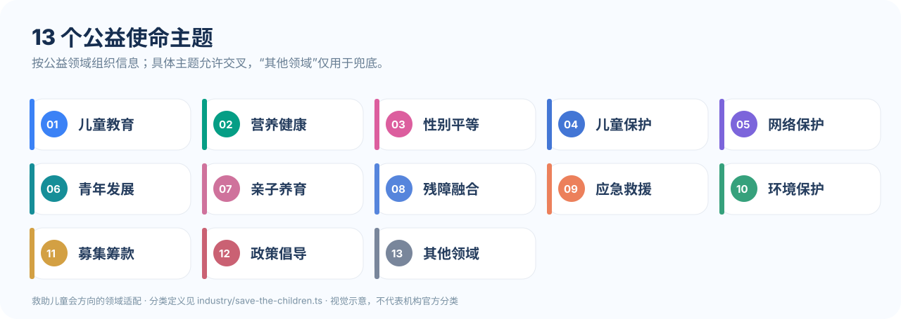
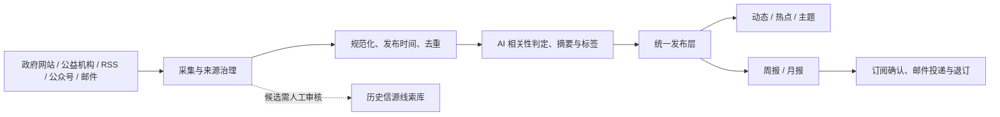

<p align="center">
  
</p>

<h1 align="center">Yi-Hot · 公益动态</h1>

<p align="center">
  
</p>
<p align="center"><sub>救助儿童会方向的儿童公益主题适配 · 机构标识归原权利人所有；本站独立维护，展示不代表官方合作或背书。</sub></p>

<p align="center">
  <strong>让值得关注的公益信息，更容易被发现、理解与追踪。</strong><br/>
  面向公益从业者、研究者与关注公共议题的读者的公益资讯聚合与 AI 辅助整理平台。
</p>

<p align="center">
  <a href="https://49.233.72.222/yihot/"><strong>🌐 浏览线上站点</strong></a> ·
  <a href="#-快速开始"><strong>🚀 自行部署</strong></a> ·
  <a href="MAINTENANCE.md"><strong>📖 完整维护手册</strong></a> ·
  <a href="docs/PROJECT_CONTEXT.md"><strong>🧭 项目交接</strong></a>
</p>

<p align="center">
  
  
  
  
</p>

> [!NOTE]
> 本项目是以 [AIHOT](https://github.com/KKKKhazix/AIHOT) 为技术基础的**独立公益领域定制版本**，不是 AIHOT 或救助儿童会的官方发行版或代表其立场的产品。本文的可视化为功能与架构**示意图**，并非真实线上页面截图。原始新闻版权归发布方所有。

## ✨ 为什么做 Yi-Hot？

公益信息散落在政府公告、社会组织网站、行业媒体、微信公众号和邮件简报里。逐个阅读费时间，直接订阅又容易被重复信息淹没。

**Yi-Hot 想减少信息搜寻和整理的重复劳动**：持续发现公开信息，区分原始发布日期与抓取时间，通过可追溯的内容分析形成动态、主题和周期性总报，帮助读者更快回到可靠的一手来源。

## 🧩 核心能力

| 发现 | 理解 | 阅读 | 持续使用 |
| :--- | :--- | :--- | :--- |
| **多渠道信源**：网站、RSS、邮件简报，以及**网页搜索 API**（按主题词主动发现公益事件）；公众号与微博通道已暂停 | **内容处理**：去重、相关性判断、摘要、翻译与结构化标签 | **动态与热点**：按原文日期查看，保留原始来源链接；动态页支持「只看未读 / 只看精选」筛选 | **周报与月报**：按自然周期汇总行业信息 |
| **信源治理**：候选发现、预览、隔离启用、健康检查 | **公益语境适配**：政策、项目、机构、儿童与其他公益领域 | **主题与机构页**：按议题交叉阅读，不只依靠关键词；另有**监管记录**，民政部的处罚与异常名录每日同步 | **邮件订阅**：双重确认、按期投递、可退订 |
| **历史资产留存**：NewsMail 与 charity-intelligence 信源线索 | **人工可复核**：留存判断链、来源和模型用量 | **分享海报**：每条都能生成带二维码的图，发群里或存下来 | **后台运维**：异常诊断、费用管理、反馈与审计；对外另有 **RSS / API / MCP / Agent Skill** 四种读取入口 |

<p align="center">
  
</p>

**按需要选入口：** [动态](https://49.233.72.222/yihot/all) 看最新信息（顶部可切「只看未读 / 只看精选」）；[主题](https://49.233.72.222/yihot/topics) 按领域阅读；[热点](https://49.233.72.222/yihot/hot) 看近期最受关注的事件；[周报 / 月报](https://49.233.72.222/yihot/weekly) 回顾周期内的重要进展。

**手机与电脑内容一致**：手机端底部固定「总报 / 动态 / 热点 / 主题 / 更多」，电脑端是左侧常驻目录栏；收藏、Agent、更新这些在手机上要进「更多」，在电脑上直接摆在侧栏。订阅入口两端都常驻。监管页目前只有手机入口和直链，电脑侧栏还没接上，见下文「接下来想做的」。

> 热点榜的「关注度」同时参考正规信源（政府、机构、媒体、邮件）与网页搜索信号：同一事件被越多**独立来源**提及、且越近发生，热度越高；只有网页搜索信号、没有权威来源背书的事件不会单独上榜。

## 🧒 救助儿童会方向：13 个使命主题

Yi-Hot 针对儿童公益议题进行了领域定制：主题词表、别名映射、前台主题筛选，以及存量内容的标签回填机制。项目维护者另开展过救助儿童会微信公众号历史文章的采集与数据分析：**原始语料（公众号全文）不入库、不公开**，而由它汇总出的《公众号内容分析》已作为只读页面发布在 [关于 → 看看这十二年写过什么](https://49.233.72.222/yihot/about/dashboard)，覆盖 2014–2026 年 1,992 篇推文，主题分布、年度特征词与共现关系都可逐项查看。它的入口在[关于](https://49.233.72.222/yihot/about)页最下方「关于我们」那一屏。

<p align="center">
  
</p>

- 主题既用于发现信息，也用于前端导航、标签与历史文章回填；具体规则见 [主题轴说明](docs/topic-axis-migration.md)。
- **内容形式**（政策、研究、项目等）与**公益主题**（儿童保护、营养健康等）是不同维度，可以同时出现。
- “其他领域”是兜底标签，不应与明确的使命领域同时出现。标签不是科学测量结论，实际质量需要持续抽样复核。

## 🧭 Yi-Hot 与 AIHOT：哪些是继承，哪些是定制？

| 层面 | 说明 |
| :--- | :--- |
| **继承 AIHOT 的核心底座** | 信息处理引擎、Web/API、任务调度、数据库模型及大量基础组件；保留原作者署名和许可 |
| **Yi-Hot 的公益定制** | 公益信源、领域词表、儿童议题主题轴、相关性与精选规则、公益内容文案与主题入口 |
| **Yi-Hot 的运营扩展** | WeRSS 公众号接入（2026-10-25 起暂停）、QQ 邮件简报、总报邮件订阅、后台候选信源治理、云端部署与交接 |
| **跨项目资产** | NewsMail 与 charity-intelligence 的历史线索以候选形式保留；**不等于**已批准或全部接入采集 |
| **上游更新** | `main` 是现用版本；`vendor/aihot-main` 与 `rebuild/aihot-aligned` 用于隔离追踪、验证更新，**不会自动替换生产** |

详情：[上游升级和重构方案](docs/AIHOT_UPSTREAM_REBUILD.md) · [信息源治理原则](docs/SOURCE_GOVERNANCE_DESIGN.md)。

## 🚀 快速开始

**前置条件：** Node.js 24.11+、Docker / Docker Compose、npm，以及可供测试的 PostgreSQL 环境。默认配置用于本机体验；真实采集、模型、公众号和邮件功能需要分别配置对应凭据与开关。

```bash
git clone https://github.com/CochraneK/Yi-hot.git
cd Yi-hot
npm ci
cp .env.example .env
node scripts/init-env.ts
docker compose up -d --build
```

本地通常访问 **http://localhost:3000**；后台通常为 **http://localhost:3000/admin**。不要将生产密钥复制到测试环境。详见 [完整维护手册](MAINTENANCE.md#十二本地开发测试同步和部署) 与 [部署说明](docs/deploy.md)。

> [!IMPORTANT]
> 仓库已公开，可直接克隆。第三方代码、机构标识与新闻内容的授权边界见 [NOTICE](NOTICE) 与 [第三方归属说明](THIRD_PARTY_NOTICES.md)——机构标识的使用不代表合作或背书。

## 🔬 架构与数据边界



**守住三条边界：** 只在允许的范围内采集；默认仅显示摘要和原文链接，不擅自转载全文；`industry/sources.json` 是 seed，**生产信源以 PostgreSQL 中的运行时配置为准**。项目不保证所有来源全天候可访问，也不保证 AI 摘要永远准确，重要事实请以原文为准。

## 🧭 接下来想做的

想法不缺，缺的是顺序。下面按**还要补什么**分三档：第一档只差一个开关，第二档要先补一个具体的东西，第三档要等外部条件。写出来不是为了许愿——知道**卡在哪**，比知道"有这个计划"更有用。

完整的想法台账（含已经落地的、以及讨论过决定不做的）在 [想法台账](docs/IDEAS.md)，那份文档同时充当"别再重复提这些"的清单。

### 一、改几处就成立

| 想做的 | 会多出什么 | 要动的地方 |
| :--- | :--- | :--- |
| **电脑端的监管入口** | 手机上从「更多」进得到监管页，电脑侧栏没有这一项 | 导航表里少一行（[`nav.ts`](apps/web/app/components/shell/nav.ts)），改动最小 |
| **扫码到期提醒** | 公众号通道快失效时，把二维码直接推到维护者的飞书，而不是等三天没更新才发觉 | 飞书通道已经通（`notify/feishu.ts`），缺的是「会话失效检测 + 推送」这一小段 |
| **精选栏目的独立入口** | 精选判定一直在跑，但目前只能在动态页勾「只看精选」 | 开关就在 `industry/features.ts` 的 `selectedFeed`，问题是要先确认门槛值不值得公开 |

### 二、得先补一个前提

| 想做的 | 会多出什么 | 现在卡在哪 |
| :--- | :--- | :--- |
| **公众号的替代通道** | 自建的 17 个公众号通道里只有 2 个能抓到内容，暂由 RSS 和机构网站补位 | 免费通道要长期维护扫码会话，目前会话已失效（所有号停在 10-12），恢复扩量前先修这个 |
| **站内问答** | 直接问「最近有没有关于困境儿童的省级政策」，拿到几条带原文链接的结果 | 问答比检索更容易编造。要先做到只答库里有的、每条可回溯、答不了就说答不了 |
| **把总报读出来（TTS）** | 通勤、做家务，或者看字吃力的读者，可以把一期周报听一遍 | 中文的数字、多音字、机构简称要专门处理；音频得预生成进缓存，否则每听一次都重新花钱 |
| **只看当地** | 按访问者所在城市，只看本地相关的儿童政策与项目 | 省级政策和转载稿没有城市字段，得先补这一层归属，才谈得上筛选 |
| **分主题订阅** | 13 个主题各订各的，只收自己关心的那一路 | 现在只有日/周/月三档；每加一档就多一套发送去重与退订口径 |
| **人工标注检验选稿** | 抽一批文章人工标「该不该选」，再和模型判定对照，把改判理由写回标准 | 要有人坐下来标几百条。没有这一步，门槛只能靠入池率反推 |
| **年报** | 现在只有日、周、月三种报告，十二年积累的站缺一份年度回顾 | 不是把 12 个月拼起来，得重新取舍哪些变化值得写 |

### 三、等外部条件或一次决心

| 想做的 | 会多出什么 | 现在卡在哪 |
| :--- | :--- | :--- |
| **域名与备案** | 一个能印在纸上的地址，而不是一串 IP | 三条路径已比较过（[域名与主机](docs/DOMAIN_AND_HOSTING.md)），卡在备案主体与新闻类资质的现实约束 |
| **生态页** | 首页之外，能看到同一套框架长出的其他站最近在写什么（8 个站的 RSS 实测全部可用） | 三个方案未决，推荐用定时任务写一份静态文档，而不是让 2C2G 的机器再多一份抓取与缓存 |
| **突发事件的快速通道** | 地震、重大事故这类不会被「每三天一轮」漏掉 | 临时加密与常规定时抢同一份预算和队列；触发条件写松了天天报警，写紧了等于没有 |
| **反爬与防白嫖** | 防止整站被别的站和 AI 爬虫搬走 | 现在只有页面级 `meta robots`；得先决定是开放还是限量，别把 RSS 和 Agent 一起挡在门外 |
| **历史数据保留策略** | 文章只会越来越多，得有一份「多少年之后怎么办」的说法 | 直接删会破坏旧报告里的引用链接，冷归档 + 旧链接仍可打开才是正解 |

## 🌱 同一套框架长出的其他站

AIHOT 是开源的，社区里有人把它换成自己的信源和判断标准，长成了各自的行业站。下面这些在 **2026-10-30 逐个打开确认在线**；**都不是本站运营**，列出来不构成推荐或背书。之所以列，是因为它们说明了一件事：同一套引擎换掉领域和标准，就能长成完全不同的样子——这也是公益版敢这么做的前提。

| 站点 | 方向 | 与本项目的关系 |
| :--- | :--- | :--- |
| [AIHOT](https://aihot.news) | AI 行业热点 | 上游原站 |
| [PsyHOT](https://psyhot.cn) | 心理学与精神医学，学界与业界双视角 | **姊妹项目**，本站的 Agent Skill 通道与付费采集写法来自它 |
| [大厂观察](https://innews.site/) | 互联网大厂动态与职场信息 | 同框架，接在自己已有的网站上 |
| [RoboHot](https://robohot.news) | 机器人产业，面向研发者与准备入行的人 | 同框架 |
| [MediaStack](https://mediastack.work/) | 音视频技术情报 | 同框架 |
| [FilmTechNews](https://filmtech.lumenghe.com) | 影视技术日报 | 同框架 |
| [青砚](https://qingyannews.cn) | 环保与双碳，另附一套公众号免费采集方案 | 同框架 |
| [拾玖跨境资讯](https://news.blues19.com) | 跨境电商，按平台政策与运营重建了主题体系 | 同框架 |
| [品牌AI外刊](https://news.sevenailab.com) | 海外品牌营销与 AI 变化，先写准入规则再筛候选 | 同框架 |
| [营销通鉴 · 平台动态](https://yingxiaoclub.com/news) | 营销平台的规则变化与新功能早报 | 同框架 |
| [AI4Math Radar](https://charlie-wang-03.github.io/ai4math-radar/) | AI for Mathematics 研究动态 | 同框架 |
| [聚身之家 AIMAN.World](https://www.aiman.world/) | 机器人产业数据库与图谱，另做 Agent 接入 | 形态相近，独立实现 |
| [VulnHOT](https://vulnhot.com) | 漏洞情报 | 形态相近，独立实现 |
| [URHOT](https://huangzhenhao90.github.io/ai-ux-research-hot/) | AI 与用户研究，零服务器的静态方案 | 形态相近，用 Python 重写了同一条管线 |
| [AI 快讯](https://hot.foxnan.com/) | AI 新闻与日报 | 形态相近，独立实现 |
| [NewsIQ](https://newsiq.xyz) | 新闻事件聚合 | 形态相近，独立实现 |
| [xabcnews](https://xabcnews.com) | AI 新闻 | 形态相近，独立实现 |

各自的做法、成本对比和我们采纳/不采纳的理由，见 [同类项目调研](docs/RELATED_PROJECTS.md)。上面有站点打不开了，欢迎提 Issue 告知。

**共养与共创。** 这些站共用一套引擎，但重复的劳动和每月的账单，目前都还由各自的作者独自承担：上游有 2,125 个 fork，至少 5 个站把同一条管线独立重写了一遍；每个站也都在各自解决「这个政府站没有 RSS」「这个日期写法没见过」。这件事有解，而且不需要谁先捐钱——先登记谁在做什么，再把适配器作为数据回贡而不是代码 fork，最后才是每人每月一元的订阅式共养（定性是订阅，不是募捐）。完整推演、成本量级、以及「跨站汇总为什么只能做索引不能混池」，见 [共创与共养](docs/COMMUNITY_MODEL.md)。

## 📖 文档导航

| 我要做什么 | 从这里开始 |
| :--- | :--- |
| **只想了解产品** | [线上站点](https://49.233.72.222/yihot/) |
| **第一次接手维护** | [完整维护手册](MAINTENANCE.md)（前三分之一是「接手人最常问的 14 个问题」人话版） |
| **换机器 / 换 AI 冷启动** | [PROJECT_CONTEXT](docs/PROJECT_CONTEXT.md)（必读：拓扑、口径、凭据、接手清单） |
| **看上一轮会话与决策沉淀** | [会话归档 2026-10-24](docs/HANDOFF-2026-10-24-CHAT-ARCHIVE.md) |
| **下一阶段做什么 / 哪些别再提** | [想法台账](docs/IDEAS.md) |
| **参与共创 / 共养，或评估这套模型** | [共创与共养](docs/COMMUNITY_MODEL.md) |
| **新增公益信源** | [信源配置](docs/sources.md) |
| **看信源现状与失败复盘** | [信源全名单](docs/SOURCE_REGISTRY.md) |
| **试用候选信源** | [候选信源试用版](docs/SOURCE_CANDIDATE_TRIAL.md) |
| **配置邮件简报** | [邮件采集部署](docs/EMAIL_SOURCE_DEPLOY.md) |
| **邮件订阅与投递** | [公益总报邮件投递](docs/EMAIL_DELIVERY.md) |
| **理解系统如何运作** | [技术架构](docs/architecture.md) |
| **评分与筛选口径** | [精选与校准](docs/selection.md) |
| **看钱花在哪 / 压成本** | [成本口径与护栏](docs/COST.md) |
| **队列积压与容量缺口** | [队列可持续](docs/QUEUE_SUSTAINABILITY.md) |
| **同步和重新部署** | [同步工具](tools/README.md) |
| **域名、备案与海外主机** | [决策记录](docs/DOMAIN_AND_HOSTING.md) |
| **跟踪 AIHOT 上游** | [升级与重构方案](docs/AIHOT_UPSTREAM_REBUILD.md) |
| **运维经验与踩坑索引** | [OPS 笔记](docs/memory/OPS.md) |

> 完整索引（历代交接单、产品更新记录、专题设计文档共 40+ 篇）见 [MAINTENANCE.md 第二十一节·专题文档索引](MAINTENANCE.md)。

## 🛟 当前状态、反馈与贡献

- **部署状态与代码状态需要分别核验。** GitHub 更新不代表腾讯云已自动部署；上线后须进行文件哈希比对和实际运行检查。
- **`main` 的 Check 已全绿**（截至 2026-10-29 的一次运行，[查看运行记录](https://github.com/CochraneK/Yi-hot/actions)）。注意：涉及数据库的后端测试须在服务器容器内的 `aihot_ci` 库运行，与本地和 CI 环境都不同；改完后端请按 `.github/workflows/check.yml` 逐步复现，别只看绿勾。
- 邮件订阅与反馈涉及个人信息。公开隐私页面的运营主体与联系信息等模板字段**尚待实际维护者完善**；在正式对外推广前需要核实。
- 欢迎通过 [Issues](https://github.com/CochraneK/Yi-hot/issues) 反馈失效信源、误判、来源归属、界面可用性与安全问题（需有仓库访问权限）。不要在公开 Issue 提交密码、个人隐私或未获授权的全文数据。

## 📜 许可与致谢

本项目基于 **[KKKKhazix/AIHOT](https://github.com/KKKKhazix/AIHOT)** 的 MIT 许可代码定制。感谢 AIHOT 的原始作者和开源贡献者。本仓库保留原始 [LICENSE](LICENSE)、[NOTICE](NOTICE) 和 [第三方归属说明](THIRD_PARTY_NOTICES.md)。AIHOT 的商标、名称及 Logo 不因代码许可而自动获得授权；救助儿童会及新闻来源的名称、标识和内容亦各有权利归属。

Agent 接入（`/api/v1/agent` 的 Markdown 回答、外部资料围栏）的**骨架来自 AIHOT**；同框架的姊妹项目 **[PsyHOT](https://github.com/zhangheqing11/PsyHOT)**（MIT，心理学方向）在这层骨架上做了减法（去掉 MCP 层），并加了站内可分发的 Agent Skill 包；付费采集通道（EveryInfra）的适配写法也是 PsyHOT 的。后两项 AIHOT 从未有过，已按公益场景重写。逐文件清单（含核对日期与行数）见 [THIRD_PARTY_NOTICES.md](THIRD_PARTY_NOTICES.md)，同类项目的写法取舍见 [docs/RELATED_PROJECTS.md](docs/RELATED_PROJECTS.md)。

---

<p align="center"><sub>Yi-Hot · 少一些重复检索，多一些真正有用的信息。 | <a href="MAINTENANCE.md">完整维护手册</a></sub></p>
