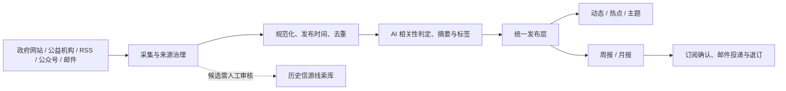

<p align="center">
  
</p>

<h1 align="center">Yi-Hot · 公益动态</h1>

<p align="center">
  
</p>
<p align="center"><sub>救助儿童会方向的儿童公益主题适配 · 机构标识归原权利人所有；本站独立维护，展示不代表官方合作或背书。</sub></p>

<p align="center">
  <strong>让值得关注的公益信息，更容易被发现、理解与追踪。</strong><br/>
  面向公益从业者、研究者与关注公共议题的读者的公益资讯聚合与 AI 辅助整理平台。
</p>

<p align="center">
  <a href="https://49.233.72.222/yihot/"><strong>🌐 浏览线上站点</strong></a> ·
  <a href="#-快速开始"><strong>🚀 自行部署</strong></a> ·
  <a href="MAINTENANCE.md"><strong>📖 完整维护手册</strong></a> ·
  <a href="docs/PROJECT_CONTEXT.md"><strong>🧭 项目交接</strong></a>
</p>

<p align="center">
  
  
  
  
</p>

> [!NOTE]
> 本项目是以 [AIHOT](https://github.com/KKKKhazix/AIHOT) 为技术基础的**独立公益领域定制版本**，不是 AIHOT 或救助儿童会的官方发行版或代表其立场的产品。本文的可视化为功能与架构**示意图**，并非真实线上页面截图。原始新闻版权归发布方所有。

## ✨ 为什么做 Yi-Hot？

公益信息散落在政府公告、社会组织网站、行业媒体、微信公众号和邮件简报里。逐个阅读费时间，直接订阅又容易被重复信息淹没。

**Yi-Hot 想减少信息搜寻和整理的重复劳动**：持续发现公开信息，区分原始发布日期与抓取时间，通过可追溯的内容分析形成动态、主题和周期性总报，帮助读者更快回到可靠的一手来源。

## 🧩 核心能力

| 发现 | 理解 | 阅读 | 持续使用 |
| :--- | :--- | :--- | :--- |
| **多渠道信源**：网站、RSS、公众号、邮件简报 | **内容处理**：去重、相关性判断、摘要、翻译与结构化标签 | **动态与热点**：按原文日期查看，保留原始来源链接 | **周报与月报**：按自然周期汇总行业信息 |
| **信源治理**：候选发现、预览、隔离启用、健康检查 | **公益语境适配**：政策、项目、机构、儿童与其他公益领域 | **主题与机构页**：按议题交叉阅读，不只依靠关键词 | **邮件订阅**：双重确认、按期投递、可退订 |
| **历史资产留存**：NewsMail 与 charity-intelligence 信源线索 | **人工可复核**：留存判断链、来源和模型用量 | **RSS / API / MCP**：向外提供标准化读取入口 | **后台运维**：异常诊断、费用管理、反馈与审计 |

<p align="center">
  
</p>

**给不同读者的三个入口：** [动态](https://49.233.72.222/yihot/all) 用于查看最新信息；[主题](https://49.233.72.222/yihot/topics) 用于按领域阅读；[周报 / 月报](https://49.233.72.222/yihot/weekly) 用于回顾周期内的重要进展。

## 🧒 救助儿童会方向：13 个使命主题

Yi-Hot 针对儿童公益议题进行了领域定制：主题词表、别名映射、前台主题筛选，以及存量内容的标签回填机制。项目维护者另开展过救助儿童会微信公众号历史文章的采集与数据分析工作；**原始语料、样本规模和完整分析报告尚未在本仓库形成可独立核验的公开研究包**，因此这里不以未经核实的数量或统计结论作为宣传指标。

<p align="center">
  
</p>

- 主题既用于发现信息，也用于前端导航、标签与历史文章回填；具体规则见 [主题轴说明](docs/topic-axis-migration.md)。
- **内容形式**（政策、研究、项目等）与**公益主题**（儿童保护、营养健康等）是不同维度，可以同时出现。
- “其他领域”是兜底标签，不应与明确的使命领域同时出现。标签不是科学测量结论，实际质量需要持续抽样复核。

## 🧭 Yi-Hot 与 AIHOT：哪些是继承，哪些是定制？

| 层面 | 说明 |
| :--- | :--- |
| **继承 AIHOT 的核心底座** | 信息处理引擎、Web/API、任务调度、数据库模型及大量基础组件；保留原作者署名和许可 |
| **Yi-Hot 的公益定制** | 公益信源、领域词表、儿童议题主题轴、相关性与精选规则、公益内容文案与主题入口 |
| **Yi-Hot 的运营扩展** | WeRSS 公众号接入、QQ 邮件简报、总报邮件订阅、后台候选信源治理、云端部署与交接 |
| **跨项目资产** | NewsMail 与 charity-intelligence 的历史线索以候选形式保留；**不等于**已批准或全部接入采集 |
| **上游更新** | `main` 是现用版本；`vendor/aihot-main` 与 `rebuild/aihot-aligned` 用于隔离追踪、验证更新，**不会自动替换生产** |

详情：[上游升级和重构方案](docs/AIHOT_UPSTREAM_REBUILD.md) · [信息源治理原则](docs/SOURCE_GOVERNANCE_DESIGN.md)。

## 🚀 快速开始

**前置条件：** Node.js 24.11+、Docker / Docker Compose、npm，以及可供测试的 PostgreSQL 环境。默认配置用于本机体验；真实采集、模型、公众号和邮件功能需要分别配置对应凭据与开关。

```bash
git clone https://github.com/CochraneK/Yi-hot.git
cd Yi-hot
npm ci
cp .env.example .env
node scripts/init-env.ts
docker compose up -d --build
```

本地通常访问 **http://localhost:3000**；后台通常为 **http://localhost:3000/admin**。不要将生产密钥复制到测试环境。详见 [完整维护手册](MAINTENANCE.md#十二本地开发测试同步和部署) 与 [部署说明](docs/deploy.md)。

> [!IMPORTANT]
> 仓库目前为 **Private**，以上克隆命令需要相应 GitHub 访问权限。若未来公开，须先排查历史提交、旧分支、凭据、第三方资产和机构品牌授权，不能只检查最新 `main`。

## 🔬 架构与数据边界



**守住三条边界：** 只在允许的范围内采集；默认仅显示摘要和原文链接，不擅自转载全文；`industry/sources.json` 是 seed，**生产信源以 PostgreSQL 中的运行时配置为准**。项目不保证所有来源全天候可访问，也不保证 AI 摘要永远准确，重要事实请以原文为准。

## 📖 文档导航

| 我要做什么 | 从这里开始 |
| :--- | :--- |
| **只想了解产品** | [线上站点](https://49.233.72.222/yihot/) · [分类和标签](docs/topic-axis-migration.md) |
| **第一次接手维护** | [完整维护手册](MAINTENANCE.md) · [交接总览](docs/PROJECT_CONTEXT.md) |
| **新增公益信源** | [信源配置](docs/sources.md) · [候选治理与核查](docs/SOURCE_CANDIDATE_TRIAL.md) |
| **配置公众号和邮件** | [WeRSS](docs/WERSS_DEPLOY.md) · [邮件采集](docs/EMAIL_SOURCE_DEPLOY.md) · [邮件发送](docs/EMAIL_DELIVERY.md) |
| **理解系统如何运作** | [技术架构](docs/architecture.md) · [评分与筛选](docs/selection.md) |
| **同步和重新部署** | [同步工具](tools/README.md) · [运行维护](docs/memory/OPS.md) |
| **跟踪 AIHOT 上游** | [升级与重构方案](docs/AIHOT_UPSTREAM_REBUILD.md) |

## 🛟 当前状态、反馈与贡献

- **部署状态与代码状态需要分别核验。** GitHub 更新不代表腾讯云已自动部署；上线后须进行文件哈希比对和实际运行检查。
- **截至 2026-10-18，`main` 的 GitHub Actions Check 尚未全绿。** 已观察到领域标签测试预期与 seed 来源数量断言需要校正；不能将其表述为全部测试通过。[查看运行记录](https://github.com/CochraneK/Yi-hot/actions)。
- 邮件订阅与反馈涉及个人信息。公开隐私页面的运营主体与联系信息等模板字段**尚待实际维护者完善**；在正式对外推广前需要核实。
- 欢迎通过 [Issues](https://github.com/CochraneK/Yi-hot/issues) 反馈失效信源、误判、来源归属、界面可用性与安全问题（需有仓库访问权限）。不要在公开 Issue 提交密码、个人隐私或未获授权的全文数据。

## 📜 许可与致谢

本项目基于 **[KKKKhazix/AIHOT](https://github.com/KKKKhazix/AIHOT)** 的 MIT 许可代码定制。感谢 AIHOT 的原始作者和开源贡献者。本仓库保留原始 [LICENSE](LICENSE)、[NOTICE](NOTICE) 和 [第三方归属说明](THIRD_PARTY_NOTICES.md)。AIHOT 的商标、名称及 Logo 不因代码许可而自动获得授权；救助儿童会及新闻来源的名称、标识和内容亦各有权利归属。

Agent 接入（`/api/v1/agent` 的 Markdown 回答层、站内可分发的 Agent Skill 包）、付费采集通道的适配写法，以及日报与热点的“单一信源席位上限”，来自同框架的姊妹项目 **[PsyHOT](https://github.com/zhangheqing11/PsyHOT)**（MIT，心理学方向），已按公益场景重写；致谢其作者。同类项目的写法取舍见 [docs/RELATED_PROJECTS.md](docs/RELATED_PROJECTS.md)。

---

<p align="center"><sub>Yi-Hot · 少一些重复检索，多一些真正有用的信息。 | <a href="MAINTENANCE.md">完整维护手册</a></sub></p>
