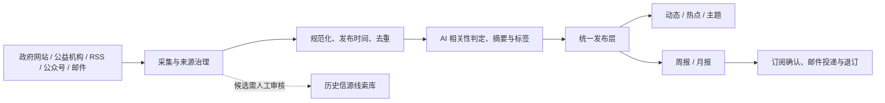

<p align="center">
  
</p>

<h1 align="center">Yi-Hot · 公益动态</h1>

<p align="center">
  
</p>
<p align="center"><sub>救助儿童会方向的儿童公益主题适配 · 机构标识归原权利人所有；本站独立维护，展示不代表官方合作或背书。</sub></p>

<p align="center">
  <strong>让值得关注的公益信息，更容易被发现、理解与追踪。</strong><br/>
  面向公益从业者、研究者与关注公共议题的读者的公益资讯聚合与 AI 辅助整理平台。
</p>

<p align="center">
  <a href="https://49.233.72.222/yihot/"><strong>🌐 浏览线上站点</strong></a> ·
  <a href="#-快速开始"><strong>🚀 自行部署</strong></a> ·
  <a href="MAINTENANCE.md"><strong>📖 完整维护手册</strong></a> ·
  <a href="docs/PROJECT_CONTEXT.md"><strong>🧭 项目交接</strong></a>
</p>

<p align="center">
  
  
  
  
</p>

> [!NOTE]
> 本项目是以 [AIHOT](https://github.com/KKKKhazix/AIHOT) 为技术基础的**独立公益领域定制版本**，不是 AIHOT 或救助儿童会的官方发行版或代表其立场的产品。本文的可视化为功能与架构**示意图**，并非真实线上页面截图。原始新闻版权归发布方所有。

## ✨ 为什么做 Yi-Hot？

公益信息散落在政府公告、社会组织网站、行业媒体、微信公众号和邮件简报里。逐个阅读费时间，直接订阅又容易被重复信息淹没。

**Yi-Hot 想减少信息搜寻和整理的重复劳动**：持续发现公开信息，区分原始发布日期与抓取时间，通过可追溯的内容分析形成动态、主题和周期性总报，帮助读者更快回到可靠的一手来源。

## 🧩 核心能力

| 发现 | 理解 | 阅读 | 持续使用 |
| :--- | :--- | :--- | :--- |
| **多渠道信源**：网站、RSS、公众号、邮件简报，以及**网页搜索 API**（按主题词主动发现公益事件） | **内容处理**：去重、相关性判断、摘要、翻译与结构化标签 | **动态与热点**：按原文日期查看，保留原始来源链接；动态页支持「只看未读 / 只看精选」筛选 | **周报与月报**：按自然周期汇总行业信息 |
| **信源治理**：候选发现、预览、隔离启用、健康检查 | **公益语境适配**：政策、项目、机构、儿童与其他公益领域 | **主题与机构页**：按议题交叉阅读，不只依靠关键词 | **邮件订阅**：双重确认、按期投递、可退订 |
| **历史资产留存**：NewsMail 与 charity-intelligence 信源线索 | **人工可复核**：留存判断链、来源和模型用量 | **RSS / API / MCP**：向外提供标准化读取入口 | **后台运维**：异常诊断、费用管理、反馈与审计 |

<p align="center">
  
</p>

**给不同读者的三个入口：** [动态](https://49.233.72.222/yihot/all) 用于查看最新信息（顶部可切「只看未读 / 只看精选」）；[主题](https://49.233.72.222/yihot/topics) 用于按领域阅读；[热点](https://49.233.72.222/yihot/hot) 用于看近期最受关注的事件；[周报 / 月报](https://49.233.72.222/yihot/weekly) 用于回顾周期内的重要进展。

**两端入口是对等的，不是两套功能**：手机端底部固定「总报 / 动态 / 热点 / 主题 / 更多」五个按钮，电脑端是左侧常驻目录栏，内容完全一致——手机上收进「更多」的监管、收藏、Agent，在电脑上直接摆在第一屏目录里。订阅入口两端都常驻：**手机**在每页顶部品牌行右侧，**电脑**在左侧目录栏底部的实色按钮（下面还有一行「或用 RSS 订阅」）。

> 热点榜的「关注度」同时参考正规信源（政府、机构、媒体、公众号、邮件）与网页搜索信号：同一事件被越多**独立来源**提及、且越近发生，热度越高；但只有网页搜索信号、没有权威来源背书的事件不会单独上榜。

## 🧒 救助儿童会方向：13 个使命主题

Yi-Hot 针对儿童公益议题进行了领域定制：主题词表、别名映射、前台主题筛选，以及存量内容的标签回填机制。项目维护者另开展过救助儿童会微信公众号历史文章的采集与数据分析：**原始语料（公众号全文）不入库、不公开**，而由它汇总出的《公众号内容分析》已作为只读页面发布在 [关于 → 看看这十二年写过什么](https://49.233.72.222/yihot/about/dashboard)，覆盖 2014–2026 年 1,992 篇推文，主题分布、年度特征词与共现关系都可逐项查看。它的入口在[关于](https://49.233.72.222/yihot/about)页最下方「关于我们」那一屏。

<p align="center">
  
</p>

- 主题既用于发现信息，也用于前端导航、标签与历史文章回填；具体规则见 [主题轴说明](docs/topic-axis-migration.md)。
- **内容形式**（政策、研究、项目等）与**公益主题**（儿童保护、营养健康等）是不同维度，可以同时出现。
- “其他领域”是兜底标签，不应与明确的使命领域同时出现。标签不是科学测量结论，实际质量需要持续抽样复核。

## 🧭 Yi-Hot 与 AIHOT：哪些是继承，哪些是定制？

| 层面 | 说明 |
| :--- | :--- |
| **继承 AIHOT 的核心底座** | 信息处理引擎、Web/API、任务调度、数据库模型及大量基础组件；保留原作者署名和许可 |
| **Yi-Hot 的公益定制** | 公益信源、领域词表、儿童议题主题轴、相关性与精选规则、公益内容文案与主题入口 |
| **Yi-Hot 的运营扩展** | WeRSS 公众号接入、QQ 邮件简报、总报邮件订阅、后台候选信源治理、云端部署与交接 |
| **跨项目资产** | NewsMail 与 charity-intelligence 的历史线索以候选形式保留；**不等于**已批准或全部接入采集 |
| **上游更新** | `main` 是现用版本；`vendor/aihot-main` 与 `rebuild/aihot-aligned` 用于隔离追踪、验证更新，**不会自动替换生产** |

详情：[上游升级和重构方案](docs/AIHOT_UPSTREAM_REBUILD.md) · [信息源治理原则](docs/SOURCE_GOVERNANCE_DESIGN.md)。

## 🚀 快速开始

**前置条件：** Node.js 24.11+、Docker / Docker Compose、npm，以及可供测试的 PostgreSQL 环境。默认配置用于本机体验；真实采集、模型、公众号和邮件功能需要分别配置对应凭据与开关。

```bash
git clone https://github.com/CochraneK/Yi-hot.git
cd Yi-hot
npm ci
cp .env.example .env
node scripts/init-env.ts
docker compose up -d --build
```

本地通常访问 **http://localhost:3000**；后台通常为 **http://localhost:3000/admin**。不要将生产密钥复制到测试环境。详见 [完整维护手册](MAINTENANCE.md#十二本地开发测试同步和部署) 与 [部署说明](docs/deploy.md)。

> [!IMPORTANT]
> 仓库目前为 **Private**，以上克隆命令需要相应 GitHub 访问权限。若未来公开，须先排查历史提交、旧分支、凭据、第三方资产和机构品牌授权，不能只检查最新 `main`。

## 🔬 架构与数据边界



**守住三条边界：** 只在允许的范围内采集；默认仅显示摘要和原文链接，不擅自转载全文；`industry/sources.json` 是 seed，**生产信源以 PostgreSQL 中的运行时配置为准**。项目不保证所有来源全天候可访问，也不保证 AI 摘要永远准确，重要事实请以原文为准。

## 📖 文档导航

| 我要做什么 | 从这里开始 |
| :--- | :--- |
| **只想了解产品** | [线上站点](https://49.233.72.222/yihot/) · [分类和标签](docs/topic-axis-migration.md) |
| **第一次接手维护** | [完整维护手册](MAINTENANCE.md) · [交接总览](docs/PROJECT_CONTEXT.md) |
| **新增公益信源** | [信源配置](docs/sources.md) · [候选治理与核查](docs/SOURCE_CANDIDATE_TRIAL.md) · [覆盖清单与失败复盘](docs/SOURCE_COVERAGE.md) · [README 内信源全名单（含失败记录）](#-信源全名单) |
| **配置公众号和邮件** | [WeRSS](docs/WERSS_DEPLOY.md) · [邮件采集](docs/EMAIL_SOURCE_DEPLOY.md) · [邮件发送](docs/EMAIL_DELIVERY.md) |
| **理解系统如何运作** | [技术架构](docs/architecture.md) · [评分与筛选](docs/selection.md) |
| **同步和重新部署** | [同步工具](tools/README.md) · [运行维护](docs/memory/OPS.md) |
| **跟踪 AIHOT 上游** | [升级与重构方案](docs/AIHOT_UPSTREAM_REBUILD.md) |

<!-- SOURCE-REGISTRY:START -->

## 🗂️ 信源全名单

> 数据时间：2026-10-24 01:09（北京时间）· 由 `scripts/export-source-registry.py` 从线上 PostgreSQL 实时生成；
> **唯一口径是入池数**（`publications.selected`，LLM 评分 ≥40），不看 found / created / 解析条数——技术接通 ≠ 内容对口。
> 这是**快照**：生产信源以数据库运行时配置为准（含 36 个只在数据库的 `web-probe-*` 探测源），重新生成方法见脚本头部注释。

| 指标 | 数值 |
| :--- | :--- |
| 源总数 | 200（`sources.json` seed 142 + 仅数据库 58） |
| 启用 / 停用 | 178 / 22 |
| 有入池 / 主力（≥5） | 151 / 102 |
| 入池文章总量 | 1326 |

| 类型 | 源数 | 启用 | 有入池 | 入池文章 | 占比 |
| :--- | :--- | :--- | :--- | :--- | :--- |
| 搜索源（DeepSeek Search） | 69 | 69 | 67 | 744 | 56% |
| 网页列表源 | 85 | 81 | 61 | 435 | 33% |
| RSS 源 | 26 | 10 | 9 | 80 | 6% |
| JSON / API 列表源 | 17 | 16 | 13 | 52 | 4% |
| 外部系统源 | 2 | 2 | 1 | 15 | 1% |

### 全部信源（按类型、按入池降序）

状态：● 主力（入池 ≥5）· 少量（1–4）· △ 有稿零入池 · ○ 从未产出 · ⚠️ 退避中 · ⛔ 停用；数字为**入池 / 产出**。

#### 搜索源（DeepSeek Search）（69 个，入池 744）

| 名称 | ID | 状态 | 入池/产出 |
| :--- | :--- | :--- | :--- |
| 网页搜索·老年人权益（DeepSeek） | `search-elderly` | ● 主力 | 43/59 |
| 网页搜索·残障融合（DeepSeek） | `search-disability` | ● 主力 | 38/58 |
| 网页搜索·儿童与公益（DeepSeek） | `search-child-rights` | ● 主力 | 36/75 |
| 网页搜索·浙江残联（DeepSeek） | `search-cdpf-zj` | ● 主力 | 32/54 |
| 网页搜索·乡村振兴（DeepSeek） | `search-rural` | ● 主力 | 29/55 |
| 网页搜索·韩红基金会（DeepSeek） | `search-found-han` | ● 主力 | 23/29 |
| 网页搜索·江苏残联（DeepSeek） | `search-cdpf-js` | ● 主力 | 21/53 |
| 网页搜索·嫣然天使（DeepSeek） | `search-found-smile` | ● 主力 | 21/25 |
| 网页搜索·江苏民政（DeepSeek） | `search-mca-js` | ● 主力 | 21/26 |
| 网页搜索·山东民政（DeepSeek） | `search-mca-sd` | ● 主力 | 21/29 |
| 网页搜索·北京民政（DeepSeek） | `search-mca-bj` | ● 主力 | 18/18 |
| 网页搜索·山东残联（DeepSeek） | `search-cdpf-sd` | ● 主力 | 17/55 |
| 网页搜索·UNHCR 难民署（DeepSeek） | `search-intl-unhcr` | ● 主力 | 17/30 |
| 网页搜索·国家卫健委（DeepSeek） | `search-mohw` | ● 主力 | 17/30 |
| 网页搜索·财政部（DeepSeek） | `search-mof` | ● 主力 | 16/28 |
| 网页搜索·南都观察/报告（DeepSeek） | `search-think-nandu` | ● 主力 | 16/27 |
| 网页搜索·北师大中国公益研究院（DeepSeek） | `search-think-tass` | ● 主力 | 16/34 |
| 网页搜索·上海残联（DeepSeek） | `search-cdpf-sh` | ● 主力 | 14/46 |
| 网页搜索·湖北民政（DeepSeek） | `search-mca-hub` | ● 主力 | 14/23 |
| 网页搜索·北京残联（DeepSeek） | `search-cdpf-bj` | ● 主力 | 12/44 |
| 网页搜索·浙江民政（DeepSeek） | `search-mca-zj` | ● 主力 | 12/21 |
| 网页搜索·中国社会报（DeepSeek） | `search-media-chinasocial` | ● 主力 | 12/29 |
| 网页搜索·社科院社会政策（DeepSeek） | `search-think-cass` | ● 主力 | 12/27 |
| 网页搜索·免费午餐（DeepSeek） | `search-found-free` | ● 主力 | 11/25 |
| 网页搜索·江西民政（DeepSeek） | `search-mca-jiangxi` | ● 主力 | 11/15 |
| 网页搜索·21世纪教育研究院（DeepSeek） | `search-think-21edu` | ● 主力 | 11/28 |
| 网页搜索·山东妇联（DeepSeek） | `search-women-sd` | ● 主力 | 11/23 |
| 网页搜索·性别平等（DeepSeek） | `search-gender` | ● 主力 | 10/60 |
| 网页搜索·上海民政（DeepSeek） | `search-mca-sh` | ● 主力 | 10/17 |
| 网页搜索·江苏妇联（DeepSeek） | `search-women-js` | ● 主力 | 10/47 |
| 网页搜索·慈善公益报（DeepSeek） | `search-media-charity` | ● 主力 | 9/22 |
| 网页搜索·浙江妇联（DeepSeek） | `search-women-zj` | ● 主力 | 9/44 |
| 网页搜索·慈善信息公开（DeepSeek） | `search-data-charity` | ● 主力 | 8/22 |
| 网页搜索·真爱梦想（DeepSeek） | `search-found-dream` | ● 主力 | 8/20 |
| 网页搜索·最高法典型案例（DeepSeek） | `search-judicial-spc` | ● 主力 | 8/52 |
| 网页搜索·公益时报（DeepSeek） | `search-media-gongyi` | ● 主力 | 8/14 |
| 网页搜索·司法部（DeepSeek） | `search-moj` | ● 主力 | 8/29 |
| 网页搜索·公安部（DeepSeek） | `search-mps` | ● 主力 | 8/30 |
| 网页搜索·上海共青团（DeepSeek） | `search-gqt-sh` | ● 主力 | 7/30 |
| 网页搜索·安徽民政（DeepSeek） | `search-mca-anhui` | ● 主力 | 7/10 |
| 网页搜索·清华公益慈善研究院（DeepSeek） | `search-think-tsinghua` | ● 主力 | 7/23 |
| 网页搜索·湖北妇联（DeepSeek） | `search-women-hub` | ● 主力 | 7/49 |
| 网页搜索·UN Women 妇女署（DeepSeek） | `search-intl-unwomen` | ● 主力 | 6/27 |
| 网页搜索·最高检未检（DeepSeek） | `search-judicial-spp` | ● 主力 | 6/25 |
| 网页搜索·山西民政（DeepSeek） | `search-mca-shanxi` | ● 主力 | 6/19 |
| 网页搜索·财新公益（DeepSeek） | `search-media-caixin` | ● 主力 | 6/17 |
| 网页搜索·湖北残联（DeepSeek） | `search-cdpf-hub` | ● 主力 | 5/28 |
| 网页搜索·湖北共青团（DeepSeek） | `search-gqt-hub` | ● 主力 | 5/30 |
| 网页搜索·UNDP 开发计划署（DeepSeek） | `search-intl-undp` | ● 主力 | 5/29 |
| 网页搜索·甘肃民政（DeepSeek） | `search-mca-gansu` | ● 主力 | 5/11 |
| 网页搜索·河北民政（DeepSeek） | `search-mca-hebei` | ● 主力 | 5/13 |
| 网页搜索·云南民政（DeepSeek） | `search-mca-yunnan` | ● 主力 | 5/9 |
| 网页搜索·人社部（DeepSeek） | `search-mohrss` | ● 主力 | 5/30 |
| 网页搜索·上海妇联（DeepSeek） | `search-women-sh` | ● 主力 | 5/24 |
| 网页搜索·江苏共青团（DeepSeek） | `search-gqt-js` | · 少量 | 4/30 |
| 网页搜索·WHO 世界卫生组织（DeepSeek） | `search-intl-who` | · 少量 | 4/30 |
| 网页搜索·法律援助（DeepSeek） | `search-judicial-legalaid` | · 少量 | 4/14 |
| 网页搜索·宁夏民政（DeepSeek） | `search-mca-ningxia` | · 少量 | 4/12 |
| 网页搜索·北大社会研究中心（DeepSeek） | `search-think-pku` | · 少量 | 4/24 |
| 网页搜索·海南民政（DeepSeek） | `search-mca-hainan` | · 少量 | 3/7 |
| 网页搜索·生态环境（DeepSeek） | `search-environment` | · 少量 | 2/59 |
| 网页搜索·山东共青团（DeepSeek） | `search-gqt-sd` | · 少量 | 2/29 |
| 网页搜索·浙江共青团（DeepSeek） | `search-gqt-zj` | · 少量 | 2/29 |
| 网页搜索·北京妇联（DeepSeek） | `search-women-bj` | · 少量 | 2/25 |
| 网页搜索·财政民生支出（DeepSeek） | `search-data-finance` | · 少量 | 1/24 |
| 网页搜索·北京共青团（DeepSeek） | `search-gqt-bj` | · 少量 | 1/30 |
| 网页搜索·世界银行（DeepSeek） | `search-intl-worldbank` | · 少量 | 1/28 |
| 网页搜索·国家统计局数据（DeepSeek） | `search-data-stats` | △ 零入池 | 0/30 |
| 网页搜索·市场监管总局（DeepSeek） | `search-samr` | △ 零入池 | 0/30 |

#### 网页列表源（85 个，入池 435）

| 名称 | ID | 状态 | 入池/产出 |
| :--- | :--- | :--- | :--- |
| 公益时报 · 公益资讯 | `gongyi-times` | ● 主力 | 31/85 |
| 壹基金·最新活动 | `web-onefoundation-news` | ● 主力 | 23/30 |
| 福建省民政厅·通知公告 | `web-probe-mzt-fujian-gov-cn-316374` | ● 主力 | 21/60 |
| 民政部·地方动态 | `web-mca-local` | ● 主力 | 19/34 |
| 河南省民政厅·公告公示 | `web-probe-mzt-henan-gov-cn-78ddfb` | ● 主力 | 19/24 |
| 广西壮族自治区民政厅·民政要闻 | `web-probe-mzt-gxzf-gov-cn-ec82f3` | ● 主力 | 18/30 |
| 公益时报·要闻 | `web-gongyishibao-yaowen` | ● 主力 | 15/21 |
| 广东省民政厅·通知公告 | `web-probe-smzt-gd-gov-cn-316374` | ● 主力 | 13/20 |
| 联合国儿童基金会全球·新闻稿 | `web-unicef-global-press` | ● 主力 | 13/14 |
| 广东省民政厅·民政要闻 | `web-probe-smzt-gd-gov-cn-ec82f3` | ● 主力 | 11/21 |
| 福建省民政厅·民政动态 | `web-probe-mzt-fujian-gov-cn-64140c` | ● 主力 | 10/62 |
| 贵州省民政厅·通知公告 | `web-probe-mzt-guizhou-gov-cn-316374` | ● 主力 | 10/20 |
| 内蒙古自治区民政厅·通知公告 | `web-probe-mzt-nmg-gov-cn-316374` | ● 主力 | 10/12 |
| 新疆维吾尔自治区民政厅·民政要闻 | `web-probe-mzt-xinjiang-gov-cn-ec82f3` | ● 主力 | 10/17 |
| 中国残联·残联要闻 | `web-cdpf-news` | ● 主力 | 9/25 |
| 中国乡村发展基金会·机构新闻 | `web-cfpa-news` | ● 主力 | 9/12 |
| 贵州省民政厅·民政要闻 | `web-probe-mzt-guizhou-gov-cn-ec82f3` | ● 主力 | 9/45 |
| 湖南省民政厅·民政要闻 | `web-probe-mzt-hunan-gov-cn-ec82f3` | ● 主力 | 9/20 |
| 中国妇女发展基金会·本会新闻 | `web-cwdf-news` | ● 主力 | 8/12 |
| 天津市民政局·通知公告 | `web-probe-mz-tj-gov-cn-316374` | ● 主力 | 8/15 |
| 中华慈善总会·通知公告 | `web-probe-www-chinacharityfederation-org-316374` | ● 主力 | 8/10 |
| 中国网信网·政策法规 | `web-cac-policy` | ● 主力 | 7/24 |
| 民政部·通知公告 | `web-mca-notice` | ● 主力 | 7/20 |
| 民政部·民政要闻 | `web-mca-civil-news` | ● 主力 | 6/24 |
| 广西壮族自治区民政厅·工作动态 | `web-probe-mzt-gxzf-gov-cn-a29c70` | ● 主力 | 6/29 |
| 陕西省民政厅·通知公告 | `web-probe-mzt-shaanxi-gov-cn-316374` | ● 主力 | 6/18 |
| 西藏自治区民政厅·工作动态 | `web-probe-mzt-xizang-gov-cn-a29c70` | ● 主力 | 6/15 |
| 最高人民检察院·新闻发布会 | `web-spp-wsfbt` | ● 主力 | 6/7 |
| 中国慈善联合会·联合会动态 | `web-cca-federation-news` | ● 主力 | 5/21 |
| 中国儿童少年基金会·动态 | `web-cctf-news` | ● 主力 | 5/19 |
| 中国社会福利基金会·工作动态 | `web-cswef-news` | ● 主力 | 5/11 |
| 民政部·业务动态 | `web-mca-business` | ● 主力 | 5/17 |
| 天津市民政局·民政要闻 | `web-probe-mz-tj-gov-cn-ec82f3` | ● 主力 | 5/15 |
| 黑龙江省民政厅·通知公告 | `web-probe-mzt-hlj-gov-cn-316374` | ● 主力 | 5/15 |
| 吉林省民政厅·通知公告 | `web-probe-mzt-jl-gov-cn-316374` | ● 主力 | 5/20 |
| 陕西省民政厅·工作动态 | `web-probe-mzt-shaanxi-gov-cn-a29c70` | ● 主力 | 5/15 |
| 教育部·工作动态 | `web-moe-news` | · 少量 | 4/41 |
| 重庆市民政局·通知公告 | `web-probe-mzj-cq-gov-cn-316374` | · 少量 | 4/10 |
| 河南省民政厅·民政要闻 | `web-probe-mzt-henan-gov-cn-ec82f3` | · 少量 | 4/12 |
| 黑龙江省民政厅·工作动态 | `web-probe-mzt-hlj-gov-cn-a29c70` | · 少量 | 4/26 |
| 青海省民政厅·通知公告 | `web-probe-mzt-qinghai-gov-cn-316374` | · 少量 | 4/9 |
| 青海省民政厅·新闻中心 | `web-probe-mzt-qinghai-gov-cn-60e980` | · 少量 | 4/17 |
| 救助儿童会中国·最新进展 | `web-savethechildren-cn` | · 少量 | 4/10 |
| 联合国儿童基金会中国香港委员会·最新消息 | `web-unicef-hk-news` | · 少量 | 4/11 |
| UNICEF Innocenti·儿童研究报告 | `web-unicef-innocenti-reports` | · 少量 | 4/6 |
| 世界银行·儿童 | `web-worldbank` | · 少量 | 4/8 |
| 生态环境部·政策文件 | `web-mee-zcwj` | · 少量 | 3/35 |
| 应急管理部·应急要闻 | `web-mem-emergency-news` | · 少量 | 3/16 |
| 南都公益基金会·机构动态 | `web-nandu-org-news` | · 少量 | 3/13 |
| 新疆维吾尔自治区民政厅·通知公告 | `web-probe-mzt-xinjiang-gov-cn-316374` | · 少量 | 3/19 |
| 西藏自治区民政厅·通知公告 | `web-probe-mzt-xizang-gov-cn-316374` | · 少量 | 3/17 |
| 辽宁省民政厅·图片新闻 | `web-probe-mzt-ln-gov-cn-0283c5` | · 少量 | 2/10 |
| 浙江省民政厅·社会组织年检公告 | `web-probe-mzt-zj-gov-cn-5b3418` | · 少量 | 2/15 |
| 今日热榜·新闻 | `web-tophub-news` | · 少量 | 2/5 |
| 中国发展简报 | `china-development-brief` | · 少量 | 1/10 |
| 中国人口福利基金会·新闻动态 | `web-cpwf-news` | · 少量 | 1/9 |
| 中国红十字基金会·新闻中心 | `web-crcf-news` | · 少量 | 1/10 |
| 国家疾控局 | `web-ndcpa` | · 少量 | 1/25 |
| 吉林省民政厅·民政要闻 | `web-probe-mzt-jl-gov-cn-ec82f3` | · 少量 | 1/18 |
| 内蒙古自治区民政厅·工作动态 | `web-probe-mzt-nmg-gov-cn-a29c70` | · 少量 | 1/14 |
| 四川省民政厅·通知公告 | `web-probe-mzt-sc-gov-cn-316374` | · 少量 | 1/8 |
| 财新网 | `web-caixin` | △ 零入池 | 0/19 |
| 中国发展研究基金会 | `web-cdrf` | △ 零入池 | 0/10 |
| 中国基金会发展论坛·行业资讯 | `web-cfforum-news` | ○ 未产出 | 0/0 |
| 中国妇女报 | `web-cnwomen-news` | △ 零入池 | 0/5 |
| 最高人民法院·新闻 | `web-court-spc-news` | △ 零入池 | 0/31 |
| 中国青年报 | `web-cyol-news` | ○ 未产出 | 0/0 |
| 共青团中央·工作动态 | `web-gqt-gzdt` | △ 零入池 | 0/8 |
| 北京新阳光慈善基金会·新闻动态 | `web-isun-news` | △ 零入池 | 0/10 |
| 中国教育报 | `web-jyb` | △ 零入池 | 0/4 |
| 生态环境部·环保要闻 | `web-mee-hjyw` | △ 零入池 | 0/19 |
| 生态环境部·新闻发布 | `web-mee-xwfb` | △ 零入池 | 0/8 |
| 国家发展改革委·通知公告 | `web-ndrc-xwfb` | ○ 未产出 | 0/0 |
| 全国人大·立法动态 | `web-npc-lfdt` | △ 零入池 | 0/7 |
| 辽宁省民政厅·社会组织评估等级结果公告 | `web-probe-mzt-ln-gov-cn-163f7d` | △ 零入池 | 0/20 |
| 四川省民政厅·工作动态 | `web-probe-mzt-sc-gov-cn-a29c70` | △ 零入池 | 0/19 |
| 中华环境保护基金会·基金会动态 | `web-probe-www-cepf-org-cn-d065ac` | ⛔ 停用 | 0/0 |
| 中国宋庆龄基金会·通知公告 | `web-probe-www-sclf-org-316374` | ⛔ 停用 | 0/0 |
| 国家统计局·通知公告 | `web-stats-tzgg` | ○ 未产出 | 0/0 |
| 救助儿童会国际·全球新闻 | `web-stc-global-news` | ⛔ 停用 | 0/0 |
| 澎湃新闻·时事 | `web-thepaper` | △ 零入池 | 0/12 |
| 联合国教科文组织 | `web-unesco` | △ 零入池 | 0/7 |
| 联合国儿童基金会中国·新闻资讯 | `web-unicef-cn-press` | ⛔ 停用 | 0/0 |
| 心和基金会·心和动态 | `web-xinhe-news` | △ 零入池 | 0/4 |
| 新华网·时政联播 | `web-xinhua-szlb` | ○ 未产出 | 0/0 |

#### RSS 源（26 个，入池 80）

| 名称 | ID | 状态 | 入池/产出 |
| :--- | :--- | :--- | :--- |
| 世界卫生组织·新闻 | `rss-who-news` | ● 主力 | 31/73 |
| 中国新闻网·滚动 | `rss-chinanews-scroll` | ● 主力 | 14/82 |
| 公益时报（微信公众号） | `wechat-gongyi-times` | ● 主力 | 10/30 |
| GiveDirectly·动态 | `rss-givedirectly` | ● 主力 | 8/13 |
| Oxfam 乐施会·新闻 | `rss-oxfam` | ● 主力 | 7/11 |
| 中国政府网·政策推送 | `rss-gov-cn` | · 少量 | 4/4 |
| Stanford Social Innovation Review | `ssir` | · 少量 | 4/47 |
| 中国新闻网·教育 | `rss-chinanews-edu` | · 少量 | 1/3 |
| 中国新闻网·健康 | `rss-chinanews-health` | · 少量 | 1/7 |
| 联合国新闻（中文） | `rss-un-news` | ⛔ 停用 | 0/0 |
| 中国美国商会 AmCham China（微信公众号） | `wechat-amcham-china` | △ 零入池 | 0/15 |
| 字节跳动公益 | `wechat-bytedance-charity` | ⛔ 停用 | 0/0 |
| 中国慈善联合会 | `wechat-china-charity-alliance` | ⛔ 停用 | 0/0 |
| 中国儿童福利 | `wechat-china-child-welfare` | ⛔ 停用 | 0/0 |
| 中国儿童福利协会 | `wechat-china-child-welfare-assoc` | ⛔ 停用 | 0/0 |
| 中国儿童中心 | `wechat-china-childrens-center` | ⛔ 停用 | 0/0 |
| 中国志愿 | `wechat-china-volunteer` | ⛔ 停用 | 0/0 |
| 广州儿童福利和权益保护 | `wechat-guangzhou-child-welfare` | ⛔ 停用 | 0/0 |
| 广州社联困境儿童关爱中心 | `wechat-guangzhou-ngo-federation-child` | ⛔ 停用 | 0/0 |
| 韩红爱心慈善基金会 | `wechat-hanhong-foundation` | ⛔ 停用 | 0/0 |
| 中国红十字会 | `wechat-red-cross-china` | ⛔ 停用 | 0/0 |
| 中国红十字会总会备灾救灾中心 | `wechat-red-cross-disaster-center` | ⛔ 停用 | 0/0 |
| 救助儿童会北京代表处 | `wechat-save-the-children-cn` | ⛔ 停用 | 0/0 |
| 社会救灾 | `wechat-social-disaster-relief` | ⛔ 停用 | 0/0 |
| 遂溪县教育发展促进会 | `wechat-suixi-education` | ⛔ 停用 | 0/0 |
| 联合国儿童基金会 | `wechat-unicef` | ⛔ 停用 | 0/0 |

#### JSON / API 列表源（17 个，入池 52）

| 名称 | ID | 状态 | 入池/产出 |
| :--- | :--- | :--- | :--- |
| 全国妇联·依法维权 | `json-women-wq` | ● 主力 | 11/21 |
| 公众号 · 中国青少年发展基金会 | `wechat-oa-cydf` | ⚠️ 退避 | 6/16 |
| 公众号 · 中国儿童少年基金会 | `wechat-oa-cctf` | ⚠️ 退避 | 5/10 |
| 公众号 · 中国乡村发展基金会 | `wechat-oa-cfrf` | ⚠️ 退避 | 5/10 |
| 公众号 · 救助儿童会北京代表处 | `wechat-oa-save-the-children` | ⚠️ 退避 | 5/10 |
| 微博 · 事实无人抚养儿童 | `weibo-search-unattended-children` | ⚠️ 退避 | 5/6 |
| 基金会中心网·动态 | `json-foundation-center-fti` | · 少量 | 3/12 |
| 小红书 · 公益项目 | `xhs-search-charity-project` | ⚠️ 退避 | 3/32 |
| 公众号 · 中华儿慈会 | `wechat-oa-ccafc` | ⚠️ 退避 | 2/10 |
| 公众号 · 中国慈善联合会 | `wechat-oa-charity-alliance` | ⚠️ 退避 | 2/10 |
| 公众号 · 联合国儿童基金会 | `wechat-oa-unicef` | ⚠️ 退避 | 2/10 |
| 微博 · 困境儿童资助 | `weibo-search-vulnerable-children` | ⚠️ 退避 | 2/8 |
| 公众号 · 中国红十字会 | `wechat-oa-red-cross` | ⚠️ 退避 | 1/10 |
| 微博 · 儿童侵害案件 | `weibo-search-child-abuse` | ⛔ 停用 | 0/0 |
| 微博 · 一对一助学 | `weibo-search-student-aid` | ⚠️ 退避 | 0/4 |
| 小红书 · 养老助老 | `xhs-search-elderly-care` | ⚠️ 退避 | 0/10 |
| 小红书 · 乡村振兴 | `xhs-search-rural-revitalization` | ⚠️ 退避 | 0/10 |

#### 外部系统源（2 个，入池 15）

| 名称 | ID | 状态 | 入池/产出 |
| :--- | :--- | :--- | :--- |
| 爱德传一基金 · 慈善纪事简报 | `email-amity-chuanyi` | ● 主力 | 15/26 |
| AmCham China Events 邮件 | `email-amcham-events` | △ 零入池 | 0/16 |

### 尝试过但失败 / 未接 / 否决的信源

> 与上面名单分开：这些**没有形成可用信源**。已接入但零入池的（评分拒绝）不在这里——它们在上面各表里标 △，按"留观察一周"纪律处理。

| 尝试对象 | 类型 | 结果 | 失败 / 受限原因 | 处置 |
| :--- | :--- | :--- | :--- | :--- |
| 国家卫健委数据 API | 数据接口 | 未接 | HTTP 412 拒接 | 只接新闻栏；改以 `search-mohw` 搜索源补齐 |
| 公安部数据 API | 数据接口 | 未接 | HTTP 521 拒接 | 只接新闻栏；改以 `search-mps` 搜索源补齐 |
| 农业农村部候选列表 | 网页 | 未接 | 核查时只返回 1 条 2026-01 旧内容 | 暂不启用，等其更新 |
| 国家卫健委妇幼健康页 | 网页 | 未接 | 生产网络触发反爬 | 暂不启用；优先找官方 RSS / JSON |
| 联合国儿童基金会中国·新闻页 | 网页 | 暂停 | 生产网络反爬，403 | `web-unicef-cn-press` 已 paused，待定 |
| UNGM（联合国采购） | 网页 | 否决 | 401 需登录 | 格式为招标公告，非新闻；按纪律不接 |
| cydf.org.cn（青基会官网） | 网页 | 否决 | 401 需登录 | 按纪律不接 |
| 腾讯公益 | 网页 | 否决 | 项目众筹平台，不是新闻列表 | 格式不对口，非技术问题 |
| EU Funding & Tenders | 网页 | 否决 | 资助机会库 / 公告 API | 提案应走官方订阅，不作新闻采集 |
| cepf.org.cn（中华环境保护基金会） | 网页 | 暂停 | HTTPS 证书错配：返回 baishan.com 的证书 | 已 paused；先 `openssl s_client` 看 CN 再定夺 |
| sclf.org（中国宋庆龄基金会） | 网页 | 暂停 | HTTPS 证书错配：返回别人域名的证书 | 已 paused；同上 |
| 中国发展简报 `/feed` | RSS | 地址失效 | 404 / 返回 HTML | 改走 `web_list`（`china-development-brief` 已接） |
| 公益时报 `/rss.xml` | RSS | 地址失效 | 404 / 返回 HTML | 改走 `web_list`（`gongyi-times` 已接） |
| UNICEF China RSS（M1 探测） | RSS | 探测被拒 | 403（测试出口被拦） | 不由此判为来源失效，不建议绕过 |
| 聚合热榜（tophub / NewsNow 等） | 热榜 | 已证伪 | 69% 链接被替换成搜索页，且拿不到发布时间 | 不采用 |
| Jina Reader（r.jina.ai） | 渲染服务 | 不可用 | 生产网络 DNS 落到 Facebook 段后超时，与凭证无关 | 弃用；改无头 chromium 渲染器（见下） |
| everyinfra 预算归零（14 源） | 采集预算 | 停摆 | `budgets.everyinfra.per_day=0`：8 公众号 + 3 微博 + 3 小红书退避 | 改回 150 即可复活（截至 2026-10-23 仍未恢复） |
| 18 个 `wechat-*` rss 源 | 公众号 | 停用 | `fail_count=0` 且无 last_error，疑似建源时即关闭 | 待查因：是漏接还是主动停用 |

**已修复的历史故障**（曾失败、现已正常，留在表外备查）：邮件源 `collect.py` 被 403（默认 UA 被边缘中间件拦）→ 换浏览器 UA（`55fa518`）；`deepseek-tools` 日预算 40 次烧光 → 调到 800（约 ¥4/天）；9 个 SPA 站点旧架构抓不到 → 无头 chromium 渲染器，7 解锁 / 2 否决。

<!-- SOURCE-REGISTRY:END -->

## 🛟 当前状态、反馈与贡献

- **部署状态与代码状态需要分别核验。** GitHub 更新不代表腾讯云已自动部署；上线后须进行文件哈希比对和实际运行检查。
- **截至 2026-10-18，`main` 的 GitHub Actions Check 尚未全绿。** 已观察到领域标签测试预期与 seed 来源数量断言需要校正；不能将其表述为全部测试通过。[查看运行记录](https://github.com/CochraneK/Yi-hot/actions)。
- 邮件订阅与反馈涉及个人信息。公开隐私页面的运营主体与联系信息等模板字段**尚待实际维护者完善**；在正式对外推广前需要核实。
- 欢迎通过 [Issues](https://github.com/CochraneK/Yi-hot/issues) 反馈失效信源、误判、来源归属、界面可用性与安全问题（需有仓库访问权限）。不要在公开 Issue 提交密码、个人隐私或未获授权的全文数据。

## 📜 许可与致谢

本项目基于 **[KKKKhazix/AIHOT](https://github.com/KKKKhazix/AIHOT)** 的 MIT 许可代码定制。感谢 AIHOT 的原始作者和开源贡献者。本仓库保留原始 [LICENSE](LICENSE)、[NOTICE](NOTICE) 和 [第三方归属说明](THIRD_PARTY_NOTICES.md)。AIHOT 的商标、名称及 Logo 不因代码许可而自动获得授权；救助儿童会及新闻来源的名称、标识和内容亦各有权利归属。

Agent 接入（`/api/v1/agent` 的 Markdown 回答、外部资料围栏）的**骨架来自 AIHOT**；同框架的姊妹项目 **[PsyHOT](https://github.com/zhangheqing11/PsyHOT)**（MIT，心理学方向）在这层骨架上做了减法（去掉 MCP 层），并加了站内可分发的 Agent Skill 包；付费采集通道（EveryInfra）的适配写法也是 PsyHOT 的。后两项 AIHOT 从未有过，已按公益场景重写。逐文件清单（含核对日期与行数）见 [THIRD_PARTY_NOTICES.md](THIRD_PARTY_NOTICES.md)，同类项目的写法取舍见 [docs/RELATED_PROJECTS.md](docs/RELATED_PROJECTS.md)。

---

<p align="center"><sub>Yi-Hot · 少一些重复检索，多一些真正有用的信息。 | <a href="MAINTENANCE.md">完整维护手册</a></sub></p>
