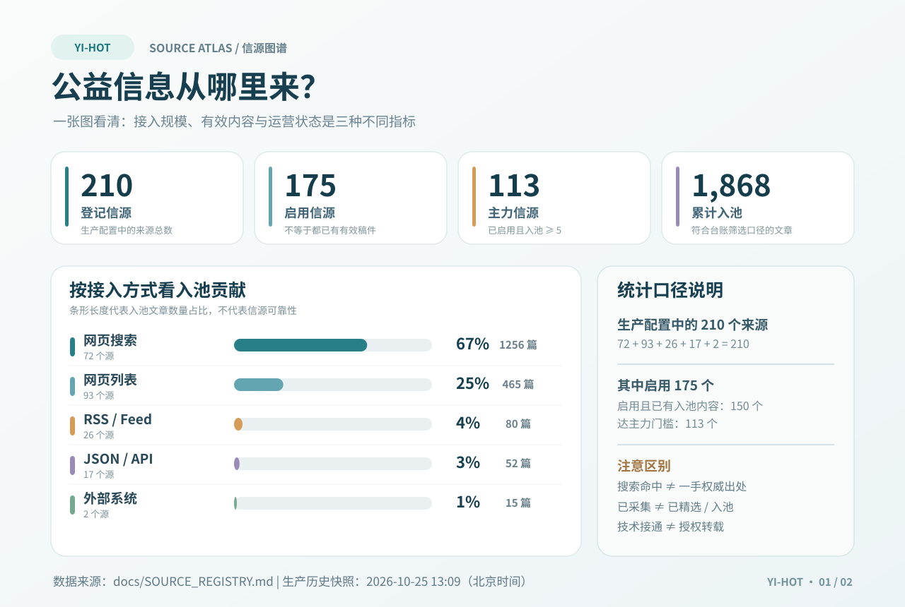
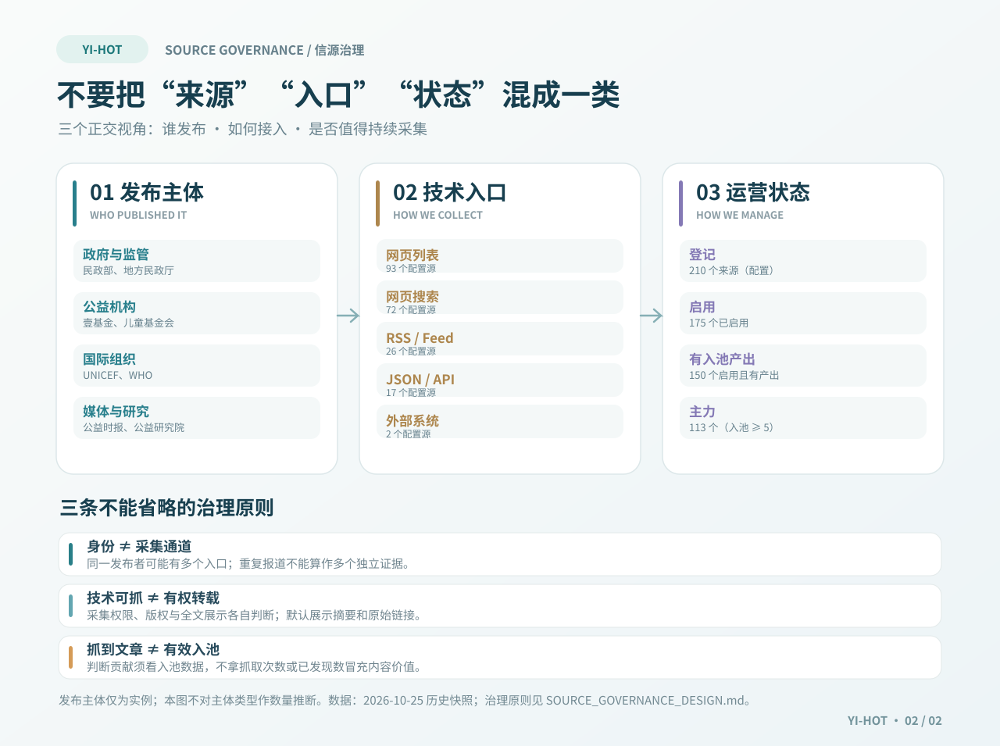

# Yi-Hot 信源分层图谱（2026-10-25 生产快照）

[← 返回 README](../README.md) · [全部信源台账](SOURCE_REGISTRY.md) · [信源治理设计](SOURCE_GOVERNANCE_DESIGN.md)

> **证据边界**：本页不是 2026-11-09 实时数据库读取结果。下述数字均来自 `docs/SOURCE_REGISTRY.md`，快照时间为 **2026-10-25 13:09 北京时间**。GitHub 中的 `industry/sources.json` 是 seed，与生产数据库不是同一个统计范围。可用 `scripts/export-source-registry.py` 在具备权限的生产环境重新导出，以获得新快照。

## 一、来源规模与实际有效贡献

| 接入方式 | 配置源 | 入池文章 | 入池占比 |
| :--- | ---: | ---: | ---: |
| 网页搜索 | 72 | 1,256 | 67% |
| 网页列表 | 93 | 465 | 25% |
| RSS / Feed | 26 | 80 | 4% |
| JSON / API | 17 | 52 | 3% |
| 外部系统 | 2 | 15 | 1% |
| **总计** | **210** | **1,868** | **100%** |

- **登记 210**：包括 175 个启用和 35 个停用；其中数据库特有的源不等于静态 seed。
- **启用且已有入池内容 150**：与“启用 175”不同，不能互换。
- **主力 113**：已启用且入池至少 5 条，不是另一批独立信源。
- **入池 1,868**：以台账定义的 `publications.selected`（评分 ≥ 40）为准；发现量、抓取量、文章产出不是同一个分母。百分比经过四舍五入。

## 二、发布者、接入方式、运营状态三维分层

1. **谁发布**：例如政府与监管部门、公益组织、国际组织、媒体/研究机构。这是发布者分类，**未统计出各类发布者数量**；不得根据上面的接入方式数量推断各主体数量。
2. **如何接入**：网页搜索、网页列表、RSS、JSON/API 和外部系统；这是技术入口，不是独立发布者或可信度等级。
3. **如何治理**：登记、启用、有效产出、主力等统计状态，以及需要人工审核、退避或暂停的运行/审查状态；不能把“可访问”“授权转载”“事实可靠”合并成一个判断。

**禁止误读**：网页搜索占入池内容 67% 只能说明该快照的内容贡献占比，不意味着 67% 都是无权威来源，也不表示搜索结果能替代原文核验。重复转载和同源不同入口不得虚增独立事实来源数。采集权限、来源可信度、内容入池价值为独立判断。

## 三、五层业务阅读导航（不是权威高低排行榜）

这套业务分层来自 [2026-11-09 全景交接报告第 9 章](YIHOT_OPERATIONS_HANDOFF_2026-11-09.md)，用于安排阅读、发现覆盖盲区，**不是**上图五种技术接入方式的别名。各层可以交叉，当前尚无按原始发布主体去重的五层数量。

| 业务层 | 代表性来源或线索 | 要回答的问题 |
| :--- | :--- | :--- |
| **① 政策与治理** | 中国政府网、民政部、教育部、两高、全国妇联、残联、省级民政部门 | 有哪些法律、政策、监管与执行规则变化？ |
| **② 国际组织与研究** | UNICEF、WHO、UNESCO、世界银行、Innocenti 等 | 哪些证据、研究、国际趋势值得对照？ |
| **③ 公益机构与执行** | 壹基金、儿童少年基金会、乡村发展基金会、公益服务机构 | 哪些项目、服务与一线实践正在发生？ |
| **④ 行业生态与合作** | 公益时报、中国发展简报、慈善联合会、邮件简报与合法的合作资讯 | 行业有哪些合作、资源与组织变化？ |
| **⑤ 社会事件与公共舆情** | 新闻媒体、司法案例、跨站搜索、事件进展 | 社会正在关注什么，是否有被忽视的问题？ |

**要点**：同一儿童权益事件可能同时出现在法院公告、机构回应、媒体报道和主题搜索中。分层能让它们互相补充，但同事件转载不应被当作多份独立证据。政策公告适合证明政策发布，机构自述适合证明其声明，二者都不保证其他事实自动为真。

## 四、回到可执行的原始台账

- 按源的 ID、链接、入池/产出数量、失败和停用原因：[SOURCE_REGISTRY.md](SOURCE_REGISTRY.md)。
- 新候选的预览和准入：[SOURCE_CANDIDATE_TRIAL.md](SOURCE_CANDIDATE_TRIAL.md)。
- 五对象正交模型、候选治理与权限纪律：[SOURCE_GOVERNANCE_DESIGN.md](SOURCE_GOVERNANCE_DESIGN.md)。**其中部分内容仍是设计方案，不表示全部已在生产部署。**
- 运营规则与文档对齐：[MAINTENANCE.md](../MAINTENANCE.md)。

本次只新增静态文档和图表，不改数据库、采集策略、预算、模型或部署；因此维护手册中的运营步骤不受影响。若未来更新快照，应同步修改这两张图、本文日期和 README 里的图注，避免将历史数据误称实时数据。
